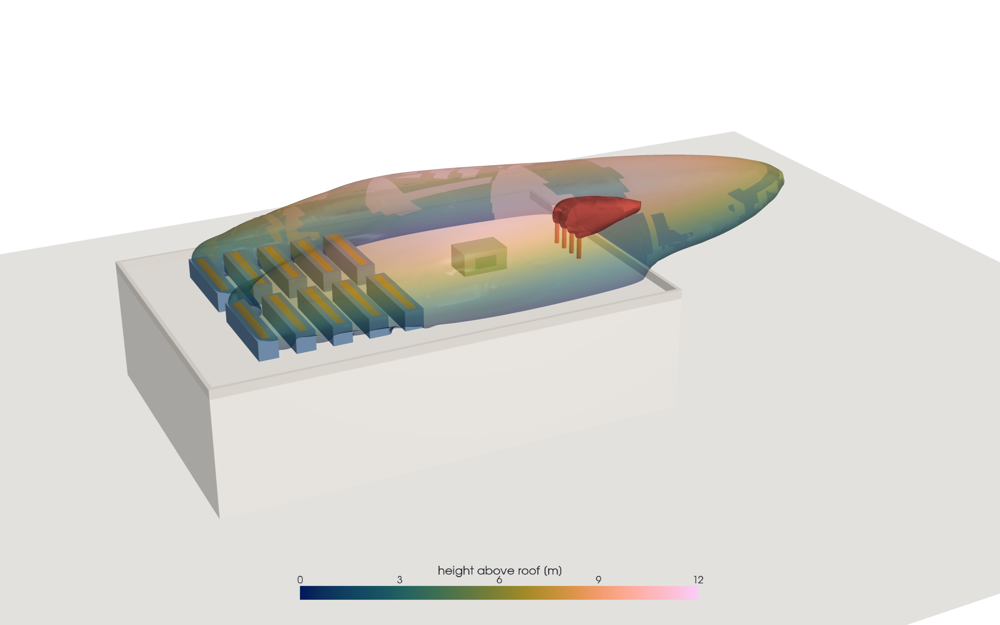
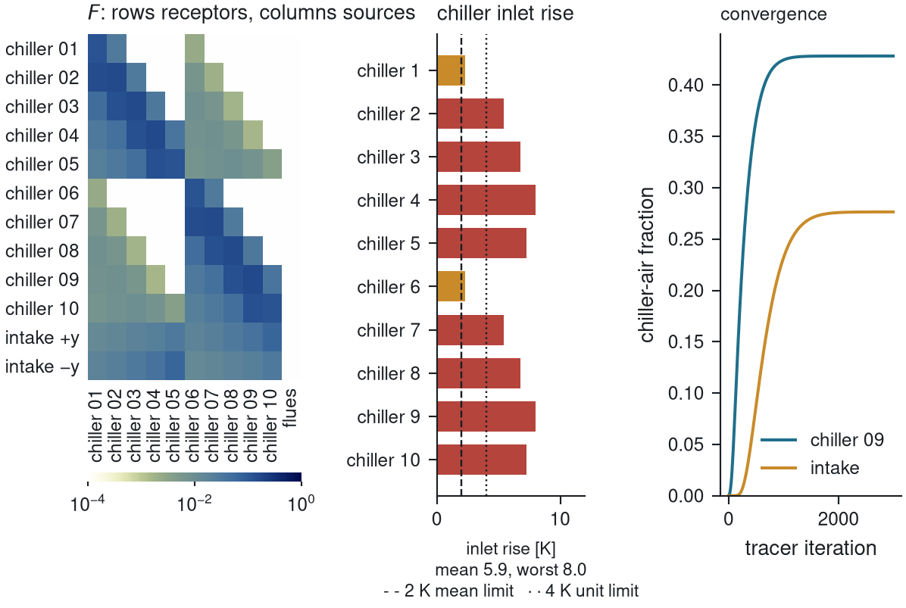
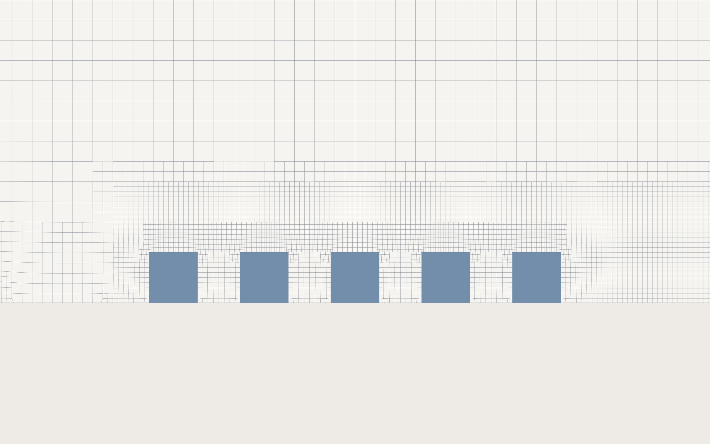
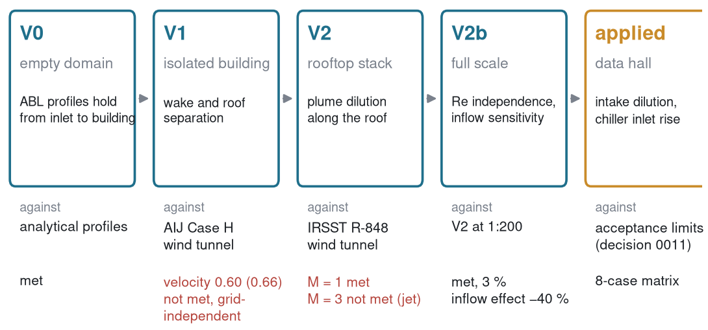
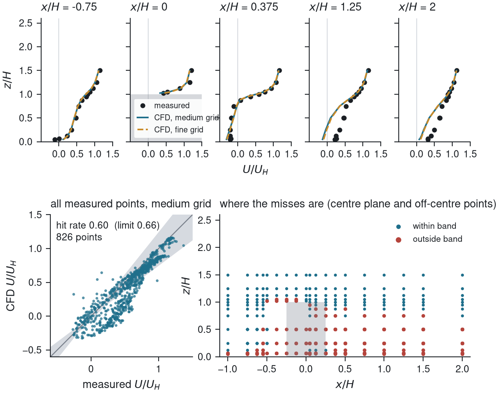
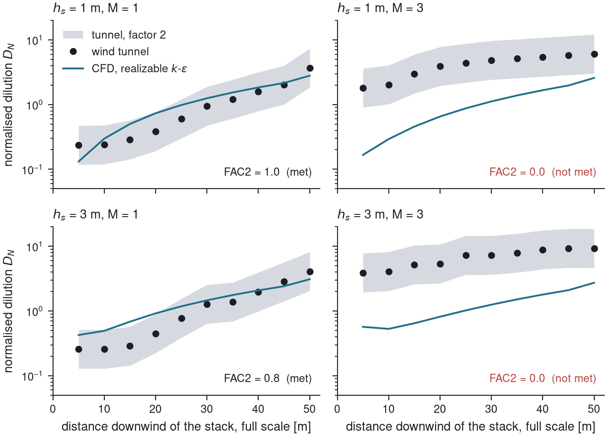
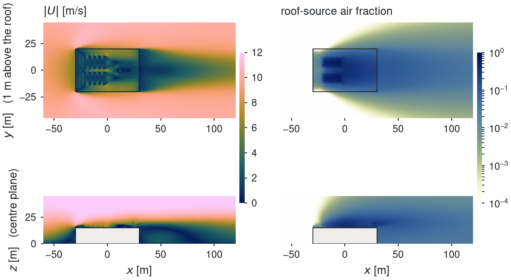

# Rooftop exhaust re-entrainment at a data hall

External CFD of a generic data-centre hall in a neutral atmospheric boundary layer: where the
chiller discharge and the generator exhaust go, and how much of each comes back into the chillers
and the fresh-air intake. OpenFOAM v2606, steady RANS, tagged passive scalars.



## The question

Ten air-cooled chillers in two rows, four generator flues and one fresh-air intake share a
60 x 40 m roof. Two things can go wrong: warm chiller discharge is drawn back into the chiller
inlets, and flue exhaust reaches the intake louvres. The study quantifies both for a matrix of wind
directions, speeds and flue heights, and reports them against fixed acceptance limits:
flue dilution at the intake of at least 2000 (NO2 at the UK hourly limit), and a chiller inlet
temperature rise of at most 2 K mean and 4 K on the worst unit (about 3 and 5 % of capacity).

## Answer so far

| wind | U at roof height | flue dilution at intake | chiller inlet rise, mean / worst unit | status |
|---|---|---|---|---|
| 0 deg (along the hall, chillers upwind) | 10 m/s | 7.6e7 | 5.9 K / 8.0 K | converged |
| 60 deg | 10 m/s | 3.3e5 | 7.1 K / 11.7 K | tracers not yet settled |
| 90 deg (flues upwind of the intake) | 10 m/s | 1.2e3 | 5.7 K / 8.8 K | tracers not yet settled |
| 0 deg | 3 m/s | 5.5e3 | 8.9 K / 11.5 K | tracers not yet settled |

The chiller limit fails at every condition, by three to six times. It is a layout problem, not a
wind problem: each unit draws from a plant deck its neighbours have already heated, and the
source-to-receptor matrix below shows which unit feeds which. The intake limit fails only when the
flues sit upwind of it. These four rows come from the first pass on a zero-thickness parapet; the
agreed eight-case matrix on the final geometry is running (see Status).



## Method

Every source on the roof carries its own passive scalar (1 at the source, 0 in the approach flow),
transported on the converged flow field. The area average of each scalar at each receptor gives
the matrix F of air fractions; the chiller rise follows from F, the 12 K discharge rise and the
feedback between units, and the intake dilution is the inverse of the flue fraction at the louvres.
Nothing is read off a plot: every number in `results/` is computed by a script from the raw
function-object output.

| item | choice | reason |
|---|---|---|
| closure | realizable k-epsilon, atmospheric wall functions (z0 = 0.3 m) | best of three closures on the AIJ building (V1) |
| inflow | log-law ABL with constant k, fixed shear at the top | holds to within 2 % over the empty domain (V0) |
| mesh | snappyHexMesh, 4 m background, 0.125 m at the chiller discharge, 2.6 M cells | grid study on V1 and V2; applied grid band pending |
| turbulent Schmidt number | 0.4 | best FAC2 on the AIJ tracer and the IRSST plume |
| sources | fixed volume flow on every intake, discharge, flue exit and louvre; flues momentum-matched to a 2 MW set | decision 0010 |



The closure was taken through a validation ladder before it touched the data hall. Each stage has
a fixed acceptance number set before the run and reported whether met or not.







The one known model-form limit matters for the flues: the eddy-viscosity closure mixes a vertical
jet out within three stack diameters at momentum ratios of 3 and above, where the tunnel data show
it surviving further. Finer meshes, k-omega SST and the SSG Reynolds-stress model did not change
this. Every intake-dilution figure therefore carries that caveat; a scale-resolving check is
triggered only if a result lands within a factor of three of the limit (decision 0013).



## Repository

```
params/        geometry and design matrix as JSON; every case is generated from these
geometry/      STL generator for the hall, plant and flues (rotation and flue height as arguments)
workflow/      case generation, mesh/flow/scalar driver, queue, resume
postproc/      metrics, matrix, figures (matplotlib) and 3D renders (PyVista, headless)
validation/    V0, V1, V2, V2b cases, metric scripts and digitised reference data
applied/       the hand-built template case the applied matrix is generated from
results/       JSON records, summary tables and figures per stage; no fields or meshes
docs/          decision records (one per modelling decision), study notebook, figures
data/          raw reference datasets with licences (data/raw/SOURCES.md)
```

## Reproduce

```bash
source env/openfoam2606.sh
python3 workflow/make_applied_case.py --dir 90 --speed 10 --out ~/scratch/applied   # one condition
bash workflow/run_applied.sh ~/scratch/applied/D0_dir090_U10                        # mesh, flow, scalars, matrix
python3 postproc/collect_applied.py results/applied --out results/applied/summary.md
python3 postproc/figures/fig_matrix.py results/applied/D0_dir090_U10.json --case ~/scratch/applied/D0_dir090_U10 --out results/applied/figures/matrix_D0_dir090_U10.png
```

Figures: `python3 postproc/figures/fig_*.py`; renders need the `viz` conda environment
(PyVista with the OSMesa build of VTK, see `postproc/render/README.md`).

## Status

Done: validation V0 to V2b, pipeline, four first-pass conditions. Running: the eight-case matrix
on the final geometry (0, 90, 180 deg at 10 m/s; 90 deg at 3 m/s; 6 m and 9 m flue tips at
90 deg; coarse and fine grids at 90 deg). Not done: oblique directions (30 to 150 deg) fail the
mesh skewness check at two chiller corners; a plant screen variant; the buoyant check in the
brief. The study notebook in `docs/study/notebook.md` records the work in the order it happened,
including what went wrong.

## Data and licences

Code: MIT. AIJ Case H data: CC BY 4.0 (Zenodo 15429872). IRSST R-848 curves: digitised from the
report (CC BY-NC-ND 4.0), published here as derived values with attribution; the report itself is
not included.
