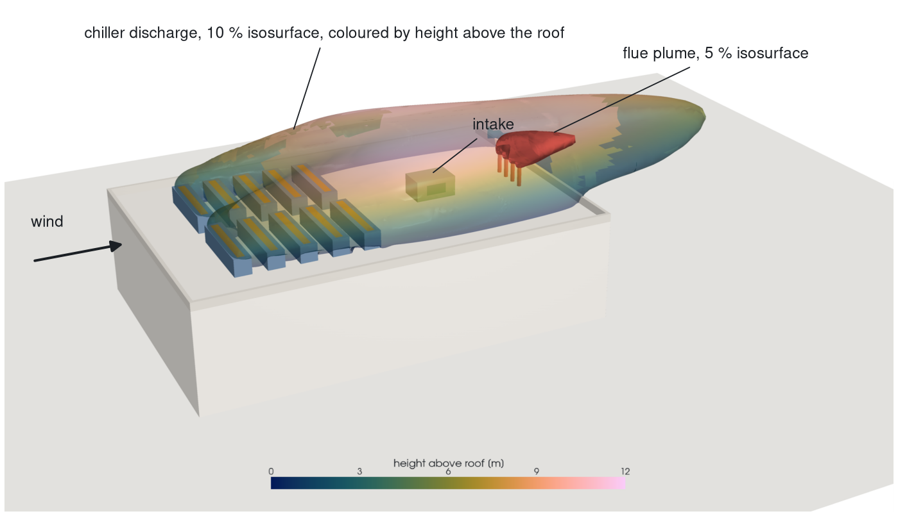
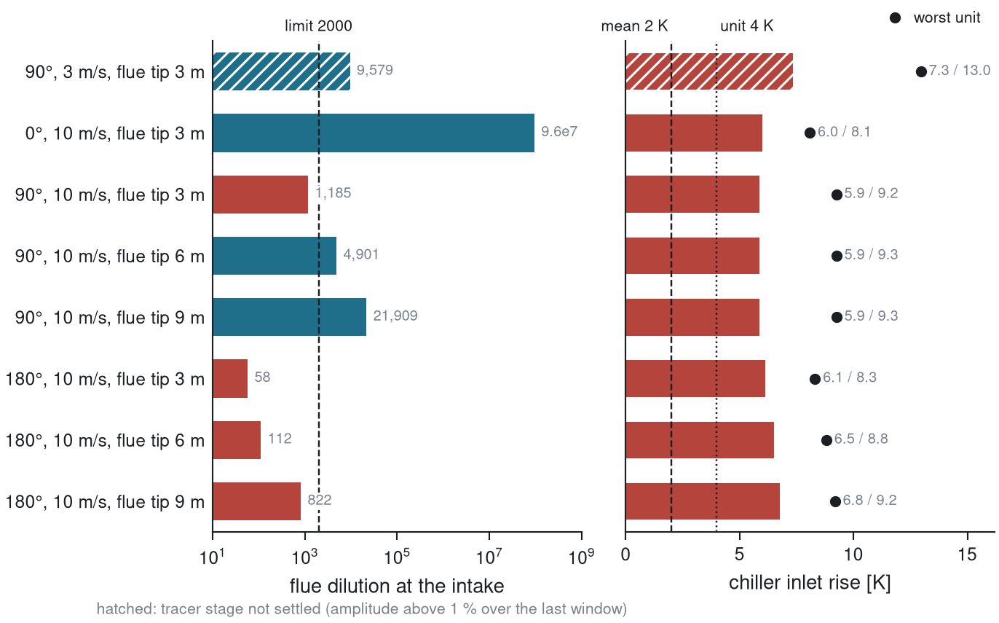
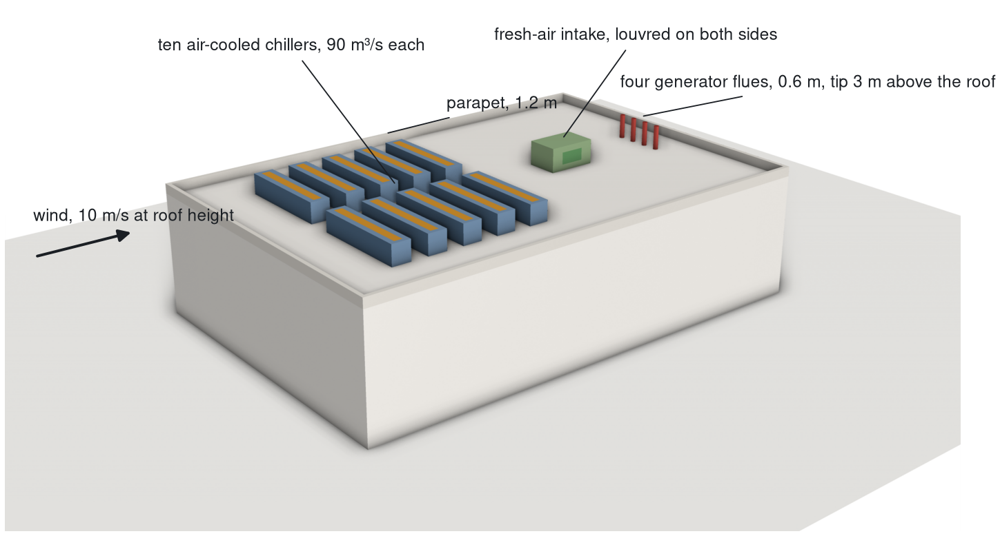

# Rooftop exhaust re-entrainment at a data hall

Steady RANS study in OpenFOAM v2606 of a generic data-centre hall in a neutral atmospheric
boundary layer. Ten rooftop chillers, four generator flues and one fresh-air intake share the
roof; the study quantifies how much chiller discharge returns to the chiller inlets and how much
flue exhaust reaches the intake, for a matrix of wind directions, speeds and flue heights.



## Results

Acceptance limits were fixed before the runs: flue dilution at the intake of at least 2,000
(NO2 at the UK hourly limit) and a chiller inlet rise of at most 2 K mean, 4 K on the worst unit.



| wind | flue tip | intake dilution | chiller rise, mean / worst unit |
|---|---|---|---|
| 0°, 10 m/s, chillers upwind of the flues | 3 m | 9.6e7 | 6.0 / 8.1 K |
| 90°, 10 m/s, across the hall | 3 m | 1,190 | 5.9 / 9.3 K |
| 90°, 10 m/s | 6 m | 4,900 | 5.9 / 9.3 K |
| 90°, 10 m/s | 9 m | 21,900 | 5.9 / 9.3 K |
| 90°, 3 m/s | 3 m | 9,580 | 7.3 / 13.0 K |
| 180°, 10 m/s, flues upwind of the intake | 3 m | 58 | 6.1 / 8.3 K |
| 180°, 10 m/s | 6 m | 112 | 6.5 / 8.8 K |
| 180°, 10 m/s | 9 m | 822 | 6.8 / 9.2 K |

**Chillers.** The limit fails at every condition by three to six times. Each downwind unit takes
13 to 17 % of its intake air from its nearest neighbour and about 40 % from the chillers as a
whole; only the upwind unit of each row is near the limit. This is the row layout, not the wind.

**Intake.** The limit fails whenever the flues are upwind of the intake. Across the wind a 6 m
flue passes with a margin of 2.4. With the flues 13 m straight upwind of the louvres, 9 m still
misses by 2.4, so that direction needs the intake or the flues moved. The 9 m result lies in the
band where the RANS jet is not trusted to settle the verdict (see Model limits); it is carried as
uncertain by at least its own margin.


## Method



Each source on the roof carries its own passive scalar on the converged flow. The area average
of each scalar at each receptor gives the matrix of air fractions above; chiller rise follows from
it with the 12 K discharge rise and the feedback between units, intake dilution is the inverse of
the flue fraction at the louvres. Every number is computed by script from the raw solver output.

Realizable k-ε with atmospheric wall functions, log-law inflow with z0 = 0.3 m, 2.6 million
cells from a 4 m background down to 0.125 m at the chiller discharge, turbulent Schmidt number
0.4, fixed volume flow at every opening. Each choice came out of the validation ladder below, with
acceptance numbers set before each run and reported whether met or not.


## Model limits

The closure mixes a vertical jet out within three stack diameters at momentum ratios of 3 and
above, where the tunnel data show it surviving further; finer meshes, k-ω SST and a
Reynolds-stress model did not change this. The flues run at momentum ratios of 1.7 to 5.7, so
every intake-dilution figure carries that caveat. A hand check with the ASHRAE minimum-dilution
method gives 19 to 30 at the worst direction against 58 from the CFD, the relation expected of a
lower bound; the hand method cannot credit plume rise, which is where the two part company at
taller flues.

Grid band at the governing condition (1.05, 2.60 and 6.70 million cells): 0.3 % on the chiller
rise, 3 % on the intake dilution, both far below the model-form uncertainty above. Not covered:
oblique wind directions (the mesh fails a skewness check at the chiller corners), plant screens,
buoyancy of the flue gas, neighbouring buildings.

## Repository

```
params/        geometry and design matrix as JSON; every case is generated from these
geometry/      STL generator for the hall, plant and flues
workflow/      case generation, mesh/flow/scalar driver, queue, resume
postproc/      metrics, matrix, figures and headless 3D renders
validation/    V0 to V2b: cases, metric scripts, digitised reference data, one README each
applied/       the template case the matrix is generated from
results/       JSON records, summary tables and figures per stage
docs/          decision records, working rules, study notebook
data/          reference datasets and their licences
```

```bash
source env/openfoam2606.sh
python3 workflow/make_applied_case.py --dir 90 --speed 10 --out ~/scratch/applied
bash workflow/run_applied.sh ~/scratch/applied/D0_dir090_U10
python3 postproc/collect_applied.py results/applied --out results/applied/summary.md
```

Code under MIT. AIJ Case H data CC BY 4.0 (Zenodo 15429872). IRSST R-848 curves digitised from
the report (CC BY-NC-ND 4.0) and published as derived values with attribution.
