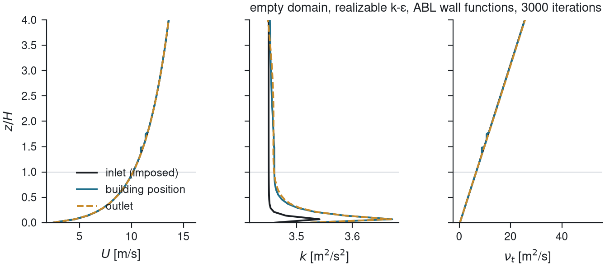

# V0: empty domain

**Question.** Do the inlet profiles of velocity, turbulent kinetic energy and dissipation reach
the building position unchanged, for each closure and wall treatment, on the mesh the applied
case will use?

**Setup.** A 9H-high box with no building, the applied domain lengths, Richards-Hoxey inlet
profiles (z0 = 0.3 m, U_H = 10 m/s at 15 m), three closures (standard k-ε with the
Hargreaves-Wright constants, realizable k-ε, k-ω SST), two ground treatments (atmospheric wall
functions, standard wall functions), two top conditions (slip, fixed shear stress), and three
first-cell heights (A: y/z0 = 6.7, B: 1.7, C: 0.8). Thirty runs, generated from
`params/V0_empty_domain.json` by `workflow/make_case.py`.

**Acceptance.** Maximum relative change of U and of k between the inlet and x = 0 below 5 %
for 0 < z < 3H; mass imbalance below 1 %; primary quantities flat over the last window.

**Answer.** Met for the atmospheric wall functions with fixed shear at the top and the medium
first cell (B): U changes by 2.1 %, k by 3.7 %. The standard wall functions drift by 10 to 20 %
in k, more as the first cell shrinks, because they impose a smooth-wall shear. k-ω SST loses
9 % of k on the coarse first cell. This selected the ground treatment, the top condition and the
first-cell rule carried into V1 and the applied case (decision 0002).

**Files.** `metrics.py` computes the numbers from `postProcessing/samples_*`;
`results/V0/summary.md` is the table; `templates/V0/` holds the dictionaries with placeholders.
